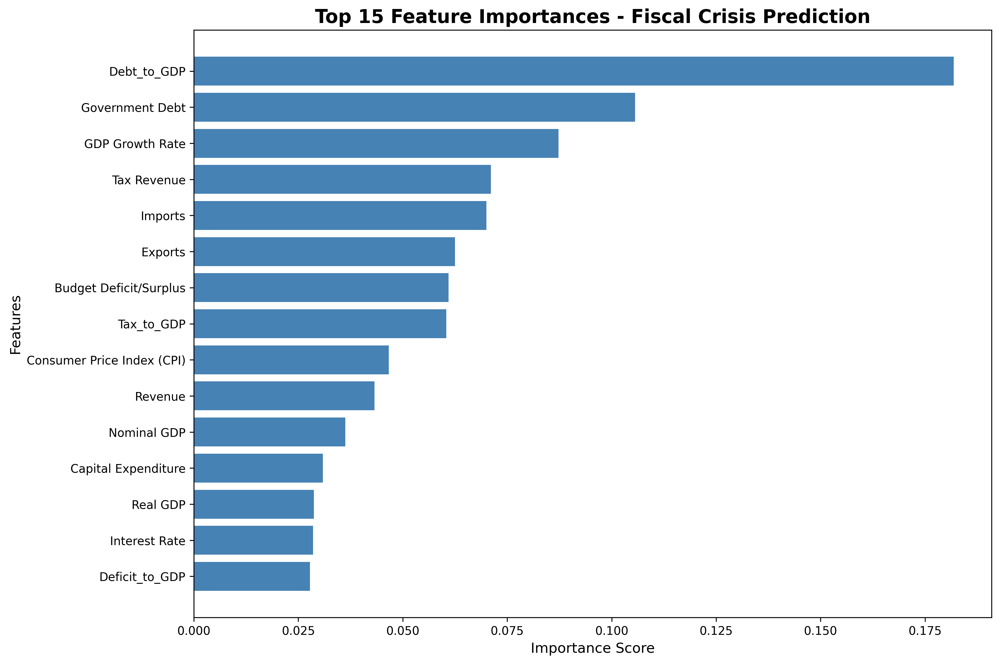

# African Sovereign Debt Crisis — Early Warning System

A small pipeline that flags next-year fiscal stress, replays a revenue shock, and shows which countries' debt ratios move together.

## Problem

Debt, revenue, and national accounts for African economies are published in different units and layouts. A heavy debt burden is easy to underestimate when those series stay separate, and stress in one country can rhyme with stress in another. This project turns a country-year fiscal panel into three views: a next-year debt-stress flag, a revenue-shock scenario, and a correlation view of debt ratios.

## Data

The panel is not in this repository. The file originally used here was assembled for the 10alytics Data Science Hackathon from national central-bank and statistics-office series. See [data/README.md](data/README.md) for where to download a replacement and how to lay it out.

Public series you can start from:

- World Bank World Development Indicators, under Creative Commons Attribution 4.0 (CC BY 4.0). Cite the World Bank.
- IMF World Economic Outlook. The tables are public; follow the IMF copyright and usage terms before redistributing a download.

No World Bank or IMF extract is shipped in this repo.

## Approach

`src/data_cleaner.py` reads a long-form workbook, scales million, billion, and trillion amounts onto a billions basis, and pivots to one row per country and year. It then builds three ratios: debt to GDP, deficit to GDP, and tax to GDP.

`src/model_engine.py` labels a row as stressed when the next year's debt-to-GDP ratio is above 70 percent. A random forest classifier, with balanced class weights, is fit on a random holdout of those rows. The same fit ranks inputs and writes a risk table for the latest year in the panel.

`src/pioneer_simulation.py` fits the same style of model, scales one country's revenue down (Nigeria when that country is present), and reads the score again. It also correlates debt-to-GDP across countries and draws a heatmap.

## Results

On the panel this pipeline was developed with, the forest leaned first on the debt ratio, then on the debt stock and GDP growth. Trade, tax revenue, and the budget balance also entered the ranking. Debt ratios did not move as one bloc: some country pairs tracked each other, and others moved in opposite directions. The revenue-shock path uses the same inputs, so a drop in revenue can be set next to the unshocked case.

The chart below is the feature ranking from that run. Treat it as a picture of that fit. Rebuild it from a public extract before using it as a current assessment.



A second chart, `outputs/contagion_correlation_heatmap.png`, shows the debt-ratio correlations.

## Next steps

- Rebuild the panel from World Bank or IMF series, with one currency per level variable, and re-fit.
- Hold out the latest years instead of splitting rows at random.
- Compare the 70 percent debt-to-GDP flag with a published debt-sustainability threshold.
- Keep the fitted model and the feature list together so the stress test does not refit on every row it is about to score.

## How to run

```bash
python3 -m venv .venv
source .venv/bin/activate
pip install -r requirements.txt
```

Place `data/raw_fiscal_data.xlsx` as described in [data/README.md](data/README.md), then:

```bash
python src/data_cleaner.py
python src/model_engine.py
python src/pioneer_simulation.py
```

`python inspect_data.py` prints the sheet names and the first rows of a workbook you have placed locally.

If the workbook or the cleaned CSV is missing, each command prints what is absent and stops. It does not train a model or write a new table.
